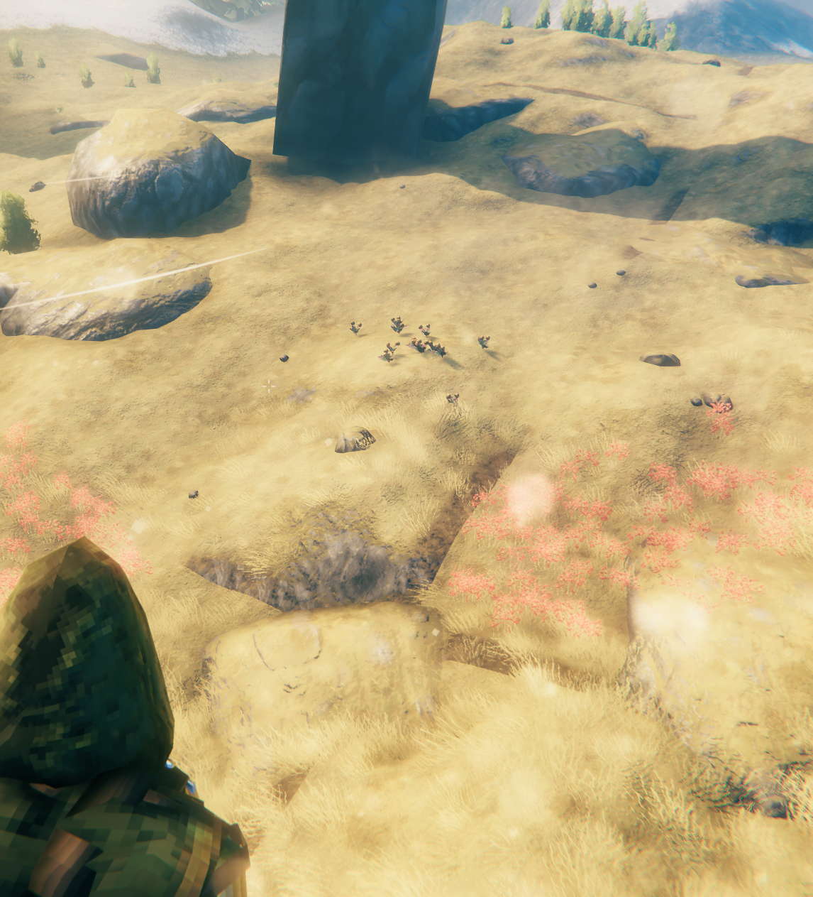
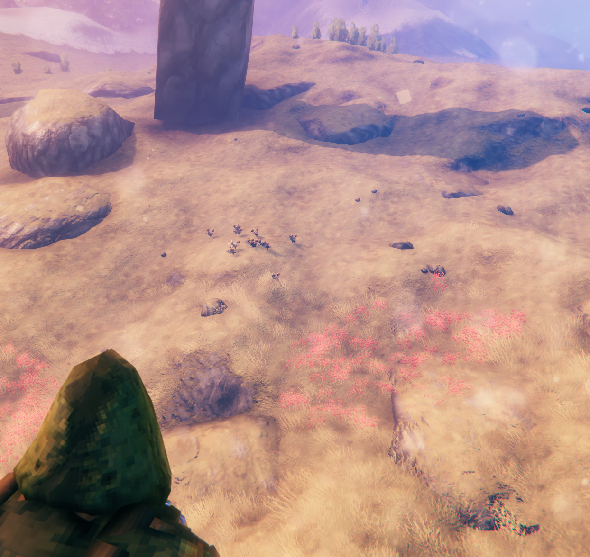
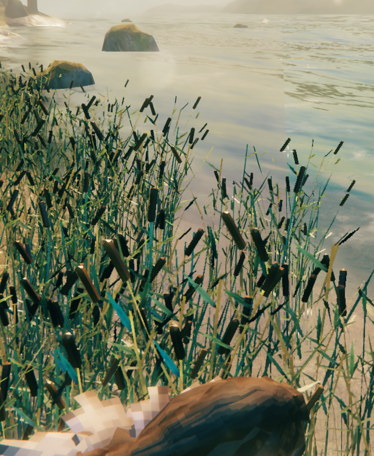
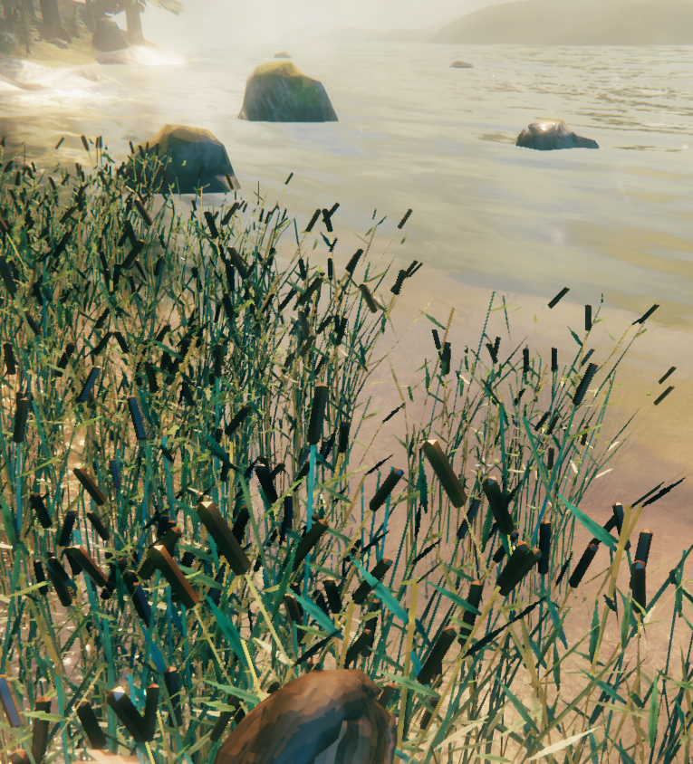

# Valheim Community Patch

Vanilla bug fixes and performance fixes. **No gameplay changes.**

This mod exists to fix things that are broken or pathologically slow in Valheim itself — crashes,
exceptions that silently kill a system, item loss, quadratic hot paths, per-frame allocations, log
spam. It deliberately ships no quality-of-life features, no balance changes, and no content, so you
can install it on a server without anyone having to agree about how the game should play.

Performance fixes are always on; the config holds only their tuning values and the admin-only Verify
diagnostics. Five change something a server or player may want back, so they can be switched off: Fix
Idle Creature Sync, Fix Creature Crowd Slowdown, Fix Portal Destination Send Delay and Fix Hourly Server
Freeze in the server config, and Fix Building Renderer Overhead by each player (Client config, Building
Render Batching). Fix Jotunn Cache Stutter is off by default; each player turns it on under Client
config, Build Jotunn Cache While Loading. Correctness
and terrain fixes each have their own toggle, on by default apart from Repair Saved Rotations. Server
memory fixes are off by default and opt-in, see [Server memory](#server-memory-opt-in). The
dedicated-server garbage collector settings moved to a separate plugin, see
[Server garbage collector](#server-garbage-collector). Config values are admin-only and
server-synced.

Each fix is tagged with the side it is worth installing on. *(server)* fixes only do something on
the machine hosting the world — a dedicated server or a listen host. *(client)* fixes need a local
player, and are **not even applied** on a dedicated server, which is why the startup log there
reports a smaller number. *(both)* fixes do work wherever they are installed. A one-sided install is
safe; it just gets you a subset. See [Installation](#installation).

### Why so many fixes are client-side

A Valheim dedicated server is not a simulation host. It only creates game objects inside its *own*
active area, and a dedicated server never has a player to anchor that area to, so the game parks it
far outside the world for the whole run. Creatures, fires, chests, tar pits and everything else near
a player are created, owned and simulated on that player's client; the server holds the data and
relays it.

So the fixes a server gains from are the data-and-network ones — ZDO handling, world load, packet
allocation, socket logging — and almost everything else is worth having on the client.

## Performance Side by Side

## Terrain Fix comparison

| Terrain Tears | Terrain Fixed |
|---|---|
|    |   |

| Shore Shade Tears | Shore Shade Fixed |
|---|---|
|    |   |

Shore tears are much more subtle as it is a shading issue. On the right side of the first image directly above the head you can see the shading issue.

## Fixes in this release

Where a fix was sourced from, or corroborated against, another modder's work, that is recorded per
fix under [Credit and sources](#credit-and-sources).

### Performance

- **Fix Portal Connection Scan** *(server)* — pairs portals through a tag index instead of rescanning
  every portal for each unconnected one every five seconds. Stands down when another mod, such as
  ZenPortal, changes how portals pair.
- **Fix World Load Connection Scan** *(server)* — pairs portals, spawners and other linked objects with
  their partners at world load through an index instead of comparing every pair, which slowed every
  server start on a large world.
- **Fix Disconnect ZDO Sweep** *(server)* — when a player disconnects, looks only at that player's
  temporary objects instead of every object in the world, which froze the server longer the bigger the
  world grew.
- **Fix Tar Pit Buffer Disposal** *(client)* — disposes tar pit raycast buffers only when they were
  allocated, so a tar pit whose load failed cannot throw out of scene teardown.
- **Fix Mist Query Overhead** *(client)* — makes the Mistlands' mist checks read a cached list of nearby
  mist volumes and the terrain height instead of scanning every mist volume and casting rays for each
  particle.
- **Fix Heightmap Lookup Scan** *(both)* — finds the terrain tile under a point with a zone-keyed lookup
  instead of scanning every loaded tile.
- **Fix Static Object Ground Checks** *(both)* — reads a tree or rock's position once per ground check
  instead of about six times.
- **Fix Grass Rebuild Burst** *(client)* — spreads a whole-area grass rebuild over a few frames, nearest
  patches first, instead of regenerating every patch in one frame.
- **Fix Terrain Builder Throughput** *(both)* — lets the terrain build thread work without pausing
  between builds and keep more finished terrain, so new zones get their ground sooner and finished
  terrain is not thrown away and built again.
- **Fix Zone Collider Stall** *(client)* — bakes the terrain collider of an already-generated zone on a
  background thread instead of the main thread.
- **Fix Prefab Query Scan** *(both)* — answers mods' "every object of this prefab" queries from an index
  instead of scanning every object in the world.
- **Fix Grass Ground Raycasts** *(client)* — reads the ground height, slope and biome for grass
  placement from terrain data instead of casting a physics ray per blade.
- **Fix Background Zone Pacing** *(server)* — defers background zone pre-generation by a tick when the
  previous frame ran long or the last generation was expensive (both configurable).
- **Fix Water Material Lookup** *(client)* — caches each water tile's surface material instead of
  fetching it every frame, and picks up a material another mod swaps in, such as Seasonality's frozen
  water, within half a second.
- **Fix Distant Terrain Hitch** *(client)* — rebuilds the far-terrain ring a few tiles per frame
  (configurable; 9 is vanilla) instead of all nine at once.
- **Fix Idle Scene Sweep** *(both)* — skips the game's 30-times-a-second pass that creates and removes
  nearby objects while nothing has changed, still running it once a second as a safety sweep.
- **Fix Support Lookup Cost** *(both)* — makes the structural support check find which building piece a
  collider belongs to from a lookup table instead of searching the object hierarchy for every hit.
- **Fix Light Flicker Overhead** *(client)* — stops updating the flicker of lights beyond both a
  configurable distance and the distance at which the game switches them off.
- **Fix Piece Event Stall** *(both)* — stops big bases stalling as they load and unload at zone borders,
  where each building piece's terrain-rebuild subscription copied or scanned a list of every other
  piece.
- **Fix Unload Sweep Cost** *(both)* — runs the object-unload sweep on a short timer (default 100 ms)
  instead of on every pass, saving frame time in object-heavy areas.
- **Fix Spawn Queue Churn** *(both)* — keeps the sorted list of objects waiting to spawn between frames
  instead of rebuilding and re-sorting it thirty times a second.
- **Fix Zone Occupancy Scan** *(both)* — answers whether a zone still holds objects from a per-zone
  tally instead of walking every loaded object.
- **Fix Piece Material Polling** *(both)* — waits for a piece's random material seed on one shared
  ticker and stops polling once the values are applied.
- **Fix Idle Support Checks** *(both)* — lets a building piece skip its structural support re-check
  until a neighbour is built, destroyed or changed, or the terrain is edited. "Support Change Threshold"
  and "Settled Piece Patience" tune how a neighbour's small drift wakes it.
- **Fix Unload Discovery Scan** *(both)* — finds objects that left the loaded area from a per-zone index
  instead of checking every loaded object, and spreads a mass unload, such as after a portal, over
  several frames instead of one freeze. "Object Unload Frame Budget" sets how many objects one unload
  pass destroys (default 250, 0 is vanilla).
- **Fix Idle Wear Visits** *(both)* — skips a building piece's whole wear update while nothing could
  change it: support settled, dry or roofed, above the waterline, outside the Ashlands and undamaged
  since the last check.
- **Fix Doubled ZDO Lookups** *(both)* — reads ZDO data with one dictionary lookup instead of two.
- **Fix Collision Contact Allocation** *(both)* — reads a collision's contact points into a reused
  buffer instead of allocating an array per collision callback.
- **Fix Collision Callback Allocation** *(both)* — has Unity reuse one collision object for every
  collision callback instead of making a new one each time; the first suspect if a physics mod that
  keeps collision objects misbehaves.
- **Fix Equipment Visual Refresh** *(client)* — re-applies a character's skin and hair color only when
  an input changed or another system overwrote it, and reads its equipment fields with one table lookup
  instead of forty.
- **Fix Light Settings Subscription** *(client)* — stops unloading many lights at once stalling the
  game, where each light scanned every other lit light to drop its graphics-settings subscription.
- **Fix Portal Idle Updates** *(client)* — stops a portal rewriting its glow, light and sound every
  frame once its connection fade has finished.
- **Fix Material Fader Settling** *(client)* — stops a finished fade re-applying unchanged material
  settings to its renderers every frame; lingering corpses are the common case.
- **Fix Cooking Slot Keys** *(both)* — stops a cooking station building throwaway text keys every second
  to read and write its slots.
- **Fix Station Range Scans** *(client)* — makes the build-mode checks for nearby crafting stations and
  extensions, which run every frame, cheaper per station.
- **Fix Smelter Catch-up Reads** *(both)* — stops a smelter catching up on missed production from
  re-reading its fuel and ore once per simulated second, which caused a frame spike when a base loads.
- **Fix Idle Sound Updates** *(client)* — drops a finished one-shot sound out of the per-frame audio
  updater list until something plays it again.
- **Fix Loading Zone Cadence** *(client)* — behind a portal, respawn or login loading screen, builds the
  zones around you nearest first, as many per tick as `Loading Zone Budget` allows (default 30 ms, 0 is
  vanilla), instead of one every 0.1 s.
- **Fix Reference Position Send Delay** *(client)* — tells the server where you are as soon as a portal,
  respawn or login moves you two or more zones, instead of at the next 2 s report, so the server starts
  sending the new area at once.
- **Fix Destination Terrain Delay** *(client)* — starts building the ground at a teleport's destination
  as the fade begins, and at your bed while you are dead, instead of only once you arrive, so the
  loading screen waits less for it.
- **Fix Portal Destination Send Delay** *(both)* — while you stand within `Portal Prefetch Range`
  (default 10 m) of a connected portal, the server sends the buildings and terrain edits at the other
  end in your connection's spare room, so the loading screen is shorter. Needs the mod on server and
  client; it has its own toggle for servers that would rather not send players areas they may not visit.
- **Fix Minimap Fog Upload** *(client)* — uploads only the patch of map fog you just revealed instead of
  the whole 8 MiB fog texture every time exploring reveals new ground.
- **Fix Server Map Rebuild** *(client)* — keeps the world map built when you join a server, Expand World
  Size maps included, and reuses it on later joins instead of freezing for seconds to build it again. A
  change to world generation is noticed and the map rebuilt; the ten newest maps live in `vcp_map_cache`
  in the game's save folder, and deleting it is safe.
- **Fix Dungeon Spawn Hitch** *(client)* — places the rooms of a dungeon or camp loading in near you
  over a few frames within `Dungeon Room Budget` (default 4 ms, 0 is vanilla) instead of all in one
  frame. A dungeon that fails to finish still frees its zone, so a door into it never hangs on the
  loading screen.
- **Fix Location Spawn Hitch** *(client)* — spawns one location per frame plus as many more as `Location
  Spawn Budget` allows (default 4 ms, 0 is vanilla) instead of every ready location in the same frame,
  so crossing into a dense area no longer hitches. Nothing waits behind a loading screen.
- **Fix Location Room Preload** *(server)* — loads each location and its dungeon rooms in the background
  as its zone comes within the area generated ahead of players, so travelling no longer leaves ground
  missing while they load. A zone you are about to enter waits at most `Location Load Wait` (default 1
  s) before loading the rest at once.
- **Fix Background Dungeon Generation** *(server)* — lays out dungeons and camps generated ahead of the
  players with lightweight stand-ins for the room models the game built only to destroy again, with the
  same result. Rooms with terrain colliders are still built in full, and the fix stands down when
  another mod hooks room placement.
- **Fix Location Model Placeholders** *(client)* — builds location and dungeon room models from a copy
  of the prefab without the chests, trees, creatures and ore the game otherwise clones into them as dead
  copies, which in the Deep North are most of the model. The game's own clone is used until a copy is
  ready, and whenever another mod hooks location spawning or room placement.
- **Fix Arriving Location Hitch** *(client)* — when the host reaches a location zone the game has not
  generated yet, generates it in the background first and then loads it a few objects per frame like
  already-generated land, instead of building all of it in one frame; the world and its dungeons come
  out the same.
- **Fix Hotbar Key Allocation** *(client)* — checks the hotbar keys with cached key names instead of
  formatting up to sixteen new strings every frame.
- **Fix Equipment Modifier Allocation** *(client)* — totals your equipment's movement, stamina and heat
  modifiers without allocating memory fifty times a second, with identical results.
- **Fix Active Area Check Allocation** *(both)* — tests whether a point is inside the loaded area
  without allocating an array per test, which wear updates, physics settling and the server's ownership
  release do thousands of times a second.
- **Fix Idle Creature Sync** *(both)* — stops a standing creature being re-sent to every player each
  frame over physics jitter; it is sent again once it moves more than 2 cm, 0.05 m/s or 1 degree. It has
  its own toggle because it changes what other players see by at most that much.
- **Fix Creature Crowd Slowdown** *(both)* — keeps the game playable with hundreds of creatures loaded,
  such as a huge breeding pen: past `Creature Update Budget` (4 ms per physics step), idle creatures
  take turns updating, while anything walking, fighting, hurt or near a player updates in full. Pens
  hold as before; it has its own toggle because it changes how a crowd moves.
- **Fix Paint-Only Terrain Rebuilds** *(both)* — when something that only paints the ground loads or
  unloads, like Black Forest rocks and copper deposits, refreshes just the paint instead of also
  rebuilding the ground's shape and collision, unless its heights changed too.
- **Fix Snow Paint Saves** *(both)* — limits how often Deep North snow saves the ground, which in
  vanilla resends a whole zone every time a fire, footstep or shovel melts or paints snow and can take a
  base with a dozen fires down to a few frames a second. Snow now saves at most once per "Snow Paint
  Save Interval", so other players see melting, and the world save holds it, up to one interval late.
- **Fix Hourly Server Freeze** *(server)* — on a dedicated server, holds the game's hourly asset
  cleanup, which freezes a large world's server for most of a second, until nobody has been connected
  for two minutes. A server that is never empty still runs it within `Asset Unload Max Delay` hours
  (default 12), and each run is logged.
- **Fix Main Menu Popup Subscription** *(client)* — stops each return to the main menu from keeping the
  old menu in memory for the rest of the session, along with every character profile and explored map it
  loaded.
- **Fix Inventory Touch Subscription** *(client)* — removes the inventory screen's touch handlers when
  it is torn down, where vanilla adds them again, so old inventory screens no longer stay in memory
  after a logout.
- **Fix Recipe Lookup Scan** *(client)* — finds an item's recipe from a cache instead of searching every
  recipe, which the crafting screen does for each worn item every frame it is open. Recipes that mods
  add, remove or change while playing are still found.
- **Fix Status Effect Lookup Scan** *(client)* — finds a status effect by name from a lookup table
  instead of searching every status effect in the game each time a character gains a new one, and still
  finds effects that mods add, remove or swap while playing.
- **Fix Active Status Effect Lookup** *(client)* — finds one of a character's active status effects by
  name from a map instead of searching its list, which every new effect and the player's own update
  every frame do.
- **Fix Grass Instance Memory** *(client)* — starts each grass renderer's blade list small and grows it
  as needed instead of reserving room for 1,024 blades, so grass takes a fraction of the memory and
  leaves far less garbage, most of all with a raised grass distance.
- **Fix GUI Pixel Snap Writes** *(client)* — has the HUD's pixel-snap component write its one-pixel
  offset only when the window size calls for a change, instead of every frame.
- **Fix Config Watcher Polling** *(both)* — has the file watchers mods use to reload their configs share
  one scan of each folder per poll instead of each re-reading the same folders, the largest source of
  garbage in a modded game. A per-machine setting can lengthen the poll further.
- **Fix Grass Build Stall** *(client)* — places the blades of each new grass patch on a background
  thread, exactly as the game would, so grass rebuilds after a load, teleport or terrain edit no longer
  stall the game. A patch being rebuilt keeps its old grass until the new one is ready.
- **Fix Building Renderer Overhead** *(client)* — draws the plain building pieces of each 16 m area as a
  few merged meshes instead of one object each, which about doubled the frame rate around a 27,000-piece
  castle. Pieces stay real pieces, and anything damaged, highlighted, glowing or with moving parts is
  drawn the game's way. On by default; each player can switch it off under Client config, Building
  Render Batching, also while playing.
- **Fix Jotunn Cache Stutter** *(client, off by default)* — builds Jotunn's lookup of loaded objects on
  the loading screen as you spawn, so the first location or dungeon from a Jotunn mod such as More World
  Locations no longer freezes the game for about a third of a second when it loads in play. It moves that
  cost onto every world load, so each player turns it on under Client config, Build Jotunn Cache While
  Loading; the log line `Built Jotunn's GameObject cache while loading` gives the cost.

### Terrain

**Fix Terrain Seams**, **Fix Terrain Paint Seams**, **Fix Swamp Plains Shore Seams** and **Fix Plains
Border Shine** change only what is drawn, never what is saved, so they are client-only. **Fix Terrain Paint Zone Fanout** and **Fix Terrain Paint Doubling** change
what is recorded, so they run on every side. **Fix Terrain Height Seams** saves nothing either, but the ground's height
is also what everything stands on, so it runs on every side too.

- **Fix Terrain Seams** *(client)* — removes the hard lighting crease along the 64 m zone grid, and
  makes distant terrain tiles cheaper to rebuild.
- **Fix Terrain Paint Seams** *(client)* — merges the two copies of the paint on a zone boundary so dirt
  continues across the line instead of stopping dead; a lone stripe on the border is dropped.
- **Fix Terrain Height Seams** *(both)* — makes the ground on both sides of a zone border meet at one
  height, closing cracks along the 64 m line through which the sky or water shows. The saved terrain is
  unchanged and edits save exactly what they would without the fix, so turning it off shows the ground
  as recorded.
- **Fix Terrain Paint Zone Fanout** *(both)* — records terrain paint into every zone it actually covers,
  including the neighbour about a metre west or south that vanilla left out; affects edits made from now
  on.
- **Fix Terrain Paint Doubling** *(both)* — applies an edit that reaches two zones once to the ground
  they share instead of twice, so piling or clearing Deep North snow no longer leaves a ridge or trench
  along the zone line.
- **Fix Swamp Plains Shore Seams** *(client)* — stops shores where swamp blends into plains from showing
  the Ashlands shoreline in straight lines along the zone grid, by bridging the two with a narrow strip
  of other ground. "Swamp Plains Bridge Ground" picks black forest (the default) or Ashlands ground for
  that strip, and "Swamp Plains Blend Sharpness" sets its width.
- **Fix Plains Border Shine** *(client)* — stops ground where black forest blends into plains from
  looking as glossy as wet Mistlands ground, which made dirt paths near those borders look wet in the
  sun, by putting a narrow strip of meadows ground between them ("Black Forest Plains Blend Sharpness"
  sets its width). With Fix Swamp Plains Shore Seams on, that fix's black forest strip also gives way to
  meadows before the plains.
- **Fix Terrain Paint Mask Indexing** *(client)* — makes the `optterrain` console command read and write
  terrain paint where it is, instead of skewed diagonally and short of each zone's edge.
- **Fix Terrain Compiler Init Race** *(both)* — recovers a zone's terrain compiler that loaded before
  its heightmap existed, instead of throwing every frame and ignoring edits.
- **Fix Terrain Compiler Duplicates** *(both)* — keeps terrain edits that reach a zone in the first
  seconds after arriving, before its saved terrain data has loaded, where vanilla lost them in that zone
  and the ground cracked along its border. It also stops the cleanup of such doubled terrain data wiping
  a neighbouring zone's raised ground and paint.

### Correctness

- **Fix Object Unload Crash** *(both)* — keeps objects unloading when an orphaned scene object is left
  behind, where vanilla throws an error every frame and nothing despawns again.
- **Tolerate Duplicate ZDOs On Load** *(server)* — loads a save containing duplicate ZDO ids, keeping
  the later one and logging a warning, instead of refusing to load.
- **Fix Effect Areas** *(both)* — stops fire warmth and wetness checks missing in dense builds, and
  stops a character that died inside an effect area causing an error every physics step.
- **Fix Fuel And Ore Loss** *(client)* — takes ownership of a smelter, kiln or fireplace before adding
  fuel or ore, so the item cannot be lost to a dropped network message.
- **Refund Rejected Station Items** *(both)* — drops an item back at the player when a smelter, kiln,
  fireplace, cooking station or fermenter rejects it because the station changed owner or filled up
  after the item left their inventory. Inactive when AutomaticFuel, or Eternal Fire older than 1.1.6, is
  installed.
- **Share Boss Defeat Keys** *(client)* — gives every nearby player the boss defeat key, not only the
  one whose game owned the boss, even on a vanilla server. With **Boss Defeat Key Requires Hit** (on by
  default) only players in range who hit the boss get it, and the world key needs one of them there. A
  boss owned by a player without the mod gives vanilla credit.
- **Fix Recipe Amount Crash** *(client)* — stops the crafting panel breaking on a "requires any one of
  these" recipe when you carry none of its ingredients.
- **Fix Spawner Null Prefabs** *(both)* — drops missing creatures from a spawner's table on load, so one
  left by a game update or a removed creature mod no longer kills the spawner.
- **Fix Projectile Rotation Spam** *(both)* — stops the `Look rotation viewing vector is zero` log line
  that a projectile at zero velocity writes every physics step.
- **Fix Send Failure Log Spam** *(both)* — redirects the per-frame `Failed to send data` log line to
  debug logging.
- **Fix Container Log Spam** *(both)* — redirects the log lines written on every chest open, stack-all
  and take-all to debug logging.
- **Fix Missing Prefab Log Spam** *(both)* — warns once per prefab that no longer exists, with a summary
  at logout, instead of once per leftover object on every spawn pass, which a client repeats for as long
  as those objects are in range.
- **Fix Area Damage Log Spam** *(both)* — moves the warning an area damage object without contact damage
  writes for everything touching it, every physics step, to debug logging; a Pufferfish on an item stand
  wrote it for as long as anything touched it.
- **Fix Container Grid Alignment** *(client)* — resets the chest grid's alignment and scroll position
  when you open a different chest, so a standard chest opened after a larger one is centered instead of
  top-aligned.
- **Fix Item Icon Crash** *(client)* — draws the first icon for an item whose saved icon variant no
  longer exists, instead of breaking every inventory, tooltip and crafting panel that shows it.
- **Fix Negative Stamina** *(client)* — keeps player stamina from going below zero or getting stuck
  after another mod changes it badly, and repairs a character that loads in that way.
- **Fix Unsaved Client Changes** *(server)* — marks remote player changes (building, chest storage) for
  the next world save, so they survive a server restart.
- **Fix Water Color Seams** *(client)* — blends sea color smoothly across zone borders instead of
  changing in a hard straight line along the 64 m grid near shores. `Water Color Shore Tint` (0 to 1,
  default 0.75) pulls the shallow-water color toward the deep-sea color; it changes color only, never
  waves.
- **Fix Unbuilt Water Depth** *(client)* — a water tile that loaded before its terrain was built reads
  its depth again once it is, instead of staying flat until the zone reloads. Only matters when another
  mod delays terrain building, such as Fires Ghetto Networking.
- **Fix Non-Item ObjectDB Entries** *(both)* — drops prefabs that are not items from the game's item
  list on load, where three added by the 2026-09-09 update break mods that treat every entry as an item.
  They can still be spawned.
- **Clear Patrol Point On Taming** *(both)* — makes a newly tamed creature stay where you keep it
  instead of running back to where it spawned, which mattered most for boars since they cannot be told
  to follow or stay. Applies to creatures tamed from now on, and the stay command works as normal.
- **Fix Map Auto-Close** *(client)* — stops the map closing for every player on the server whenever
  anyone wakes or kills a boss. It still closes for a player with a boss within `Map Auto-Close Boss
  Range` (default 100 m, the boss health bar range).
- **Fix Biome Sector Lookup** *(both)* — makes the player's biome, weather, spawn levels and the map's
  biome name match the actual biome near borders, and stops the `GetBiome error` warning. World
  generation keeps the game's lookup, so land looks the same with or without the fix.
- **Fix Loading Screen Hang** *(both)* — unregisters a networked object destroyed without the game being
  told, so a dungeon exit, portal trip or respawn next to it finishes loading; vanilla leaves one behind
  each time another player opens an Infested Mine treasure pile near you.
- **Fix Equipment Texture Errors** *(client)* — stops the `doesn't have a texture property` errors each
  Deep North Shadow logs when it is created, about eleven per Shadow and several Shadows per village;
  the Shadow looks the same.
- **Fix Unkillable Creatures** *(both)* — finishes the death of a creature stuck at zero health and
  ignoring every hit, mostly Deep North creatures whose owner changed during their death animation and
  creatures whose death another mod broke. A creature whose health another mod made `NaN` is put back to
  full health.
- **Fix Cloth Wind Shelter Errors** *(both)* — stops the `MagicaCloth component not found` error, stack
  trace included, that a Root Crown logs each time one is dropped, put on a stand or worn by a player
  coming into range; the crown looks the same.
- **Fix Loading Screen Wait** *(both)* — ends a portal, respawn or login loading screen once the
  buildings and terrain edits around you have arrived and been built, instead of after a fixed 8 seconds
  that can drop you under floors that have not arrived. A dedicated server needs the mod too, or the
  game's own timings apply; past `Loading Confirmation Timeout` (default 20 s) the game's own checks
  decide.
- **Fix Lost Bed Spawn Point** *(client)* — keeps your bed as the respawn point for up to 30 s while the
  server has not yet sent the area around it, instead of sending you to the world start, which mods that
  shorten the respawn wait made common.
- **Fix Love Potion Spawns** *(client)* — makes the Love Potion attract starred trolls again, as it did
  before the Deep North update: while it lasts, trolls spawn more often in your zone, up to two at once,
  with at least one star. In multiplayer the drinker needs the mod too.
- **Fix Pathfinding Link Limit** *(both)* — when the engine's path-finding links are nearly used up,
  drops tiles nobody has used for 10 s instead of 60 s, so sailing or taking portals past coasts full of
  creatures no longer leaves creatures unable to find paths and the log full of link errors.
- **Fix Pathfinding Link Churn** *(both)* — makes creatures' navigation links on closely stacked floors
  land on the same floor every time instead of being replaced every few seconds, which some modded
  dungeons hit constantly.
- **Fix Settings Window Disconnect** *(client)* — removes the graphics settings' change handler when a
  disconnect or kick destroys the settings window, so later graphics changes no longer throw errors or
  skip updating the next world's terrain and grass.
- **Fix Looping Sound Muting** *(client)* — keeps looping sounds such as beehives, fermenters and
  spinning wheels playing after they stop and start again, and stops unrelated sounds nearby, such as a
  cold cauldron, from muting them.
- **Fix Rock Hit Crash** *(both)* — stops a hit from a mod, or from a player the rock's owner has not
  loaded yet, failing halfway and leaving part of a leviathan, meteorite or other rock mined in parts
  unbreakable and without its drops.
- **Fix Damage Reaction Order** *(both)* — status effects that strike back when you are hit, such as
  frost orbs, react to each hit before a shield absorbs it, whichever was applied first. Vanilla's own
  frost orbs fire on any hit, so the difference shows with mods' reaction effects.
- **Fix Status Effect Regen Application Order** *(client)* — health, stamina and eitr regen from status
  effects add up the same whichever order the effects were applied in, so penalties such as Wet,
  Freezing or Puke always apply to bonuses such as Rested.
- **Fix Double Click Sound** *(client)* — plays one click and vibration when an inventory tab or button
  such as Craft, Upgrade, Skills, Trophies or the PVP toggle is pressed, instead of the button's own
  click plus the identical gamepad panel-switch click.
- **Fix Lighting After Teleport** *(client)* — keeps the lighting right after a portal, a dungeon door,
  logging in or respawning, instead of going flat and orange for a few seconds and sweeping back in.
- **Fix Lightning Flash Lighting** *(client)* — stops a lightning flash from staying in the lighting for
  up to three seconds after it is over.
- **Fix Shield Skill Credit** *(both)* — gives the Blood Magic a Staff of Protection shield earns when
  it breaks to the player who cast it, instead of whoever wore it or nobody for a tamed creature. The
  caster and the shielded player both need the mod; otherwise the game's own behaviour applies or the
  credit is lost.
- **Fix Shield Tool Damage** *(both)* — stops a shield, such as the Staff of Protection's or a Fuling
  shaman's, using up its strength on chop and pickaxe damage that cannot hurt its wearer, which let a
  single Bonemass punch break even a Blood Magic 100 shield.
- **Fix Switch Button Glyphs** *(client)* — with Switch button glyphs, the A, B, X and Y hints name the
  button the action is really on; vanilla's named the opposite button, so the X shown for Use was on the
  button labelled Y.
- **Fix Scythe Harvest** *(client)* — lets the scythe cut every plant the game marks as harvestable,
  including Magecaps, Jotun Puffs, mushrooms, dandelions, thistles, fiddleheads and smoke puffs; berry
  bushes are not marked and stay hand-picked.
- **Fix Rare Drop Pity** *(both)* — makes every star level of a creature count toward one rare drop
  countdown per item, which pays out at the listed chance from the first kill; vanilla kept one per star
  level, so dry streaks ran long. Each machine counts for the creatures it owns, as in vanilla, and the
  No Pseudo Drops world modifier still works.
- **Fix Anti-Sting Concoction** *(both)* — makes Deathsquitos flee a player under the Anti-Sting
  Concoction whichever game runs their AI, not only the drinker's own. The player who drank it and the
  player running the Deathsquito both need the mod.
- **Fix Ruin Item Despawn** *(both)* — lets dropped items despawn in Ashlands ruins as they do anywhere
  else outside a player's base, while items near a base built in a ruin still stay. Items already lying
  in a ruin despawn the next time the area loads with nobody close by.
- **Fix Spawns Inside Bases** *(client)* — stops creatures spawning inside your base while its
  workbenches and fires are not loaded yet, which happens at the lowest Simulation Distance while moving
  through a base. Spawning elsewhere, at higher settings, and from spawners allowed inside a base is
  unchanged.
- **Repair Saved Rotations** *(server, off by default)* — turns building pieces that a save before
  Valheim 1.0.30 left half a degree short back to where they were placed, when the world loads. A
  building mod's 1 degree steps can land on the same angles, so the admin decides; loading the world
  logs how many pieces sit there. Pieces that this mod's old Fix Saved Rotations saved as placed are
  left alone.
- **Fix Fence Gate Rain Damage** *(both)* — stops the wood fence gate taking damage in the rain or under
  water, as the wood fence it is built into does not. The game that owns the gate, usually the closest
  player's, works out rain damage, so every player should have the mod. Damage a gate already took stays
  until it is repaired.
- **Fix Recipe Discovery** *(client)* — learns a recipe as soon as you know its crafting ingredients,
  even at a crafting station, where vanilla also asked for the upgrade item most Deep North weapon and
  armor recipes list.
- **Fix Treasure Chest Discovery** *(both)* — counts each treasure chest once in your stats instead of
  on every open, and stops chests that should count nothing, such as the meadows chest and the wardrobe,
  logging a `Failed to find rpc method` warning.
- **Fix Armor Stand Cape Crash** *(both)* — stops the game crashing when an armor stand shows a cape,
  including a stand that wore one in a world from before the Deep North update; the cape still rests on
  the stand as before.
- **Fix Old Armor Stand Slots** *(both)* — gives back the shield, cape and utility item on armor stands
  from worlds made before the Deep North update, which the world upgrade left unreadable and lost with
  the stand; each stand is repaired as it loads.

The log fixes, Fix Biome Sector Lookup's warning, Fix Equipment Texture Errors and Fix Cloth Wind
Shelter Errors redirect rather than delete: turn on `EnableDebugMode` and the messages come back.

### Server memory (opt-in)

These are **off by default**. Each trades a little re-allocation or a shorter safety margin for
memory a busy dedicated server otherwise never gets back, which is the operator's call, so each
has its own toggle in the `Fixes - Server Memory` config section. They exist for servers whose
memory climbs with uptime under many players; a small server gains little from them. The `vcp_zdomem` server
console command (an admin can run it remotely) and the `Log ZDO Memory Stats` diagnostic print the
sizes involved, so the effect can be seen before and after turning one on.

- **Evict Dead ZDO Records** *(server)* — lets the server forget a destroyed object after `Dead ZDO
  Retain Seconds` (default 600) instead of keeping every one until the world reloads. The record only
  guards against stale copies a player might send back, which arrive within seconds of the destroy.
- **Trim ZDO Data Pool** *(server)* — caps the pools that recycle objects' field tables at `ZDO Data
  Pool Max Depth` per type and clears the strings and byte arrays a recycled table still holds, so
  memory can come back down from the busiest moment since the world loaded. A plateau rather than a
  climb, and the smaller of the two.

### Server garbage collector

The dedicated-server garbage collector settings and the `vcp_gc` console command that shipped in
0.31.0 are now a separate plugin,
[Valheim Community Patch GC](https://thunderstore.io/c/valheim/p/MidnightMods/ValheimCommunityPatchGC/).
They read and write the Mono runtime's own memory, which malware scanners flag. Install it on a
dedicated server alongside this mod; it pre-grows the collector's mark stack against
`Unexpected mark stack overflow` crashes on large worlds. The old `Server - Garbage Collector`
section in this mod's config is no longer read and can be deleted.

## Credit and sources

This mod fixes vanilla defects, and other modders found — and in several cases already fixed — a good
number of them first. Where that is true it is recorded below, and in a comment at the top of the
patch file.

[vpo]: https://github.com/ontrigger/ValheimPerformanceOptimizations

The mods involved:

- **[ComfyMods](https://github.com/redseiko/ComfyMods)** — redseiko (GPL-3.0), the same licence as
  this project. Seven of its mods — BetterZeeLog, LetMePlay, BetterServerPortals, Scenic, Effectual,
  Atlas and ComfyAutoRepair — account for eleven of the entries below.
- **[ValheimPerformanceOptimizations](https://github.com/ontrigger/ValheimPerformanceOptimizations)**
  — ontrigger (MIT). Independent corroboration of one of the performance entries below.
- **[MyPitsDontLeak](https://github.com/AzumattDev/MyPitsDontLeak)** — Azumatt (MIT).
- **Zen.ModLib** — ZenDragon. Used as a reference; no code was used.
- **Iron Gate Studio** — Valheim itself. The decompiled game source is the reference used to locate
  defects; no game code is redistributed.

### Performance

| Fix | Sourced from | What came from there |
| --- | --- | --- |
| Fix Portal Connection Scan | ComfyMods — BetterServerPortals | The indexing algorithm |
| Fix World Load Connection Scan | ComfyMods — Atlas | Its `ConnectSpawners` approach, extended here to portals and sync transforms |
| Fix Disconnect ZDO Sweep | MidnightsFX | — |
| Fix Tar Pit Buffer Disposal | MyPitsDontLeak — Azumatt | The root cause; our implementation is a transpiler rather than wholesale method replacement |
| Fix Mist Query Overhead | MidnightsFX | — |
| Fix Heightmap Lookup Scan | MidnightsFX | — |
| Fix Static Object Ground Checks | MidnightsFX | — |
| Fix Grass Rebuild Burst | MidnightsFX | — |
| Fix Terrain Builder Throughput | MidnightsFX | — |
| Fix Zone Collider Stall | MidnightsFX | — |
| Fix Prefab Query Scan | MidnightsFX | — |
| Fix Grass Ground Raycasts | MidnightsFX | — |
| Fix Background Zone Pacing | MidnightsFX | — |
| Fix Water Material Lookup | MidnightsFX | — |
| Fix Distant Terrain Hitch | MidnightsFX | — |
| Fix Idle Scene Sweep | MidnightsFX | — |
| Fix Support Lookup Cost | MidnightsFX; corroborated by [ontrigger's ValheimPerformanceOptimizations][vpo] (MIT) | Arrived at the same map-probe and lazy-default forms, and the single-fetch centre of mass |
| Fix Light Flicker Overhead | MidnightsFX | — |
| Fix Piece Event Stall | MidnightsFX | — |
| Fix Unload Sweep Cost | MidnightsFX | — |
| Fix Spawn Queue Churn | MidnightsFX | — |
| Fix Zone Occupancy Scan | MidnightsFX | — |
| Fix Piece Material Polling | MidnightsFX | — |
| Fix Idle Support Checks | MidnightsFX | — |
| Fix Unload Discovery Scan | MidnightsFX | — |
| Fix Idle Wear Visits | MidnightsFX | — |
| Fix Doubled ZDO Lookups | MidnightsFX | — |
| Fix Collision Contact Allocation | MidnightsFX | — |
| Fix Collision Callback Allocation | MidnightsFX | — |
| Fix Equipment Visual Refresh | MidnightsFX | — |
| Fix Light Settings Subscription | MidnightsFX | — |
| Fix Portal Idle Updates | MidnightsFX | — |
| Fix Material Fader Settling | MidnightsFX | — |
| Fix Cooking Slot Keys | Iron Gate Studio | The key-hash pattern, taken from `ArmorStand.InitKeys` |
| Fix Station Range Scans | MidnightsFX | — |
| Fix Smelter Catch-up Reads | MidnightsFX | — |
| Fix Idle Sound Updates | MidnightsFX | — |
| Fix Loading Zone Cadence | MidnightsFX | — |
| Fix Reference Position Send Delay | MidnightsFX | — |
| Fix Destination Terrain Delay | MidnightsFX | — |
| Fix Portal Destination Send Delay | MidnightsFX | — |
| Fix Minimap Fog Upload | MidnightsFX | — |
| Fix Server Map Rebuild | MidnightsFX | — |
| Fix Dungeon Spawn Hitch | MidnightsFX | — |
| Fix Location Spawn Hitch | MidnightsFX | — |
| Fix Location Room Preload | MidnightsFX | — |
| Fix Background Dungeon Generation | MidnightsFX | — |
| Fix Arriving Location Hitch | MidnightsFX | — |
| Fix Location Model Placeholders | MidnightsFX | — |
| Fix Hotbar Key Allocation | MidnightsFX | — |
| Fix Equipment Modifier Allocation | MidnightsFX | — |
| Fix Active Area Check Allocation | MidnightsFX | — |
| Fix Idle Creature Sync | MidnightsFX | — |
| Fix Creature Crowd Slowdown | MidnightsFX | — |
| Fix Paint-Only Terrain Rebuilds | MidnightsFX | — |
| Fix Snow Paint Saves | MidnightsFX | — |
| Fix Hourly Server Freeze | MidnightsFX | — |
| Fix Main Menu Popup Subscription | MidnightsFX | — |
| Fix Inventory Touch Subscription | MidnightsFX | — |
| Fix Recipe Lookup Scan | ComfyMods — ComfyAutoRepair | The recipe cache; change detection added here |
| Fix Status Effect Lookup Scan | searica | Contributed the fix ([#22](https://github.com/MidnightsFX/Valheim-Community-Patch/pull/22)) |
| Fix Active Status Effect Lookup | searica | Contributed the fix ([#22](https://github.com/MidnightsFX/Valheim-Community-Patch/pull/22)) |
| Fix Grass Instance Memory | MidnightsFX | — |
| Fix GUI Pixel Snap Writes | MidnightsFX | — |
| Fix Config Watcher Polling | MidnightsFX | — |
| Fix Grass Build Stall | MidnightsFX | — |
| Fix Building Renderer Overhead | MidnightsFX | — |
| Fix Jotunn Cache Stutter | MidnightsFX | — |

### Terrain

| Fix | Sourced from | What came from there |
| --- | --- | --- |
| Fix Terrain Seams | MidnightsFX | — |
| Fix Terrain Paint Seams | MidnightsFX | — |
| Fix Terrain Height Seams | MidnightsFX | — |
| Fix Terrain Paint Zone Fanout | MidnightsFX | — |
| Fix Terrain Paint Doubling | MidnightsFX | — |
| Fix Swamp Plains Shore Seams | MidnightsFX | — |
| Fix Plains Border Shine | MidnightsFX | — |
| Fix Terrain Paint Mask Indexing | MidnightsFX | — |
| Fix Terrain Compiler Init Race | MidnightsFX | — |
| Fix Terrain Compiler Duplicates | MidnightsFX | — |

### Correctness

| Fix | Sourced from | What came from there |
| --- | --- | --- |
| Fix Object Unload Crash | ComfyMods — Scenic | The approach |
| Tolerate Duplicate ZDOs On Load | ComfyMods — Atlas | The duplicate-id tolerance |
| Fix Effect Areas | ComfyMods — Effectual | Both defects; our fix for the dangling reference differs |
| Fix Fuel And Ore Loss | Zen.ModLib (catalogue) | The root cause; rewritten as prefixes |
| Share Boss Defeat Keys | Zen.ModLib (catalogue) | The defect and approach; rewritten with one globally registered RPC |
| Fix Recipe Amount Crash | Zen.ModLib (catalogue) | The defect, rewritten |
| Fix Spawner Null Prefabs | ComfyMods — LetMePlay | The same fix |
| Require Lit Fire | Zen.ModLib (catalogue) | The defect, rewritten |
| Fix Run Attack Stamina Drain | Zen.ModLib (catalogue) | The defect; narrowed here to players only |
| Fix Projectile Rotation Spam | ComfyMods — BetterZeeLog | The same fix |
| Fix Send Failure Log Spam | ComfyMods — BetterZeeLog | The defect; that mod removes the call, this one redirects it |
| Fix Container Log Spam | ComfyMods — BetterZeeLog | The defect; that mod removes the calls, this one redirects them |
| Fix Missing Prefab Log Spam | Redseiko | — |
| Fix Area Damage Log Spam | MidnightsFX | — |
| Fix Container Grid Alignment | Dreamwraith | Contributed the fix ([#19](https://github.com/MidnightsFX/Valheim-Community-Patch/pull/19)) |
| Fix Item Icon Crash | ComfyMods — LetMePlay | The defect; a smaller fix here that leaves the shared item data alone |
| Fix Negative Stamina | MidnightsFX | — |
| Fix Unsaved Client Changes | MidnightsFX | — |
| Fix Water Color Seams | MidnightsFX | — |
| Fix Unbuilt Water Depth | MidnightsFX | — |
| Fix Non-Item ObjectDB Entries | MidnightsFX | — |
| Clear Patrol Point On Taming | MidnightsFX | — |
| Fix Map Auto-Close | MidnightsFX | — |
| Fix Biome Sector Lookup | MidnightsFX | — |
| Fix Loading Screen Hang | MidnightsFX | — |
| Fix Equipment Texture Errors | nezuma — ShadowPersonMaterialFix | The defect; that mod swaps the Shadow's shader, this one guards the reads |
| Fix Unkillable Creatures | MidnightsFX | The `NaN` health handling follows StarLevelSystem's |
| Fix Loading Screen Wait | MidnightsFX | — |
| Fix Lost Bed Spawn Point | MidnightsFX | — |
| Fix Love Potion Spawns | MidnightsFX | — |
| Fix Pathfinding Link Limit | MidnightsFX | — |
| Fix Pathfinding Link Churn | Warp | The root cause and the approach ([#27](https://github.com/MidnightsFX/Valheim-Community-Patch/issues/27)) |
| Fix Settings Window Disconnect | MidnightsFX | — |
| Fix Looping Sound Muting | MidnightsFX | — |
| Fix Rock Hit Crash | searica | Contributed the fix ([#21](https://github.com/MidnightsFX/Valheim-Community-Patch/pull/21)) |
| Fix Damage Reaction Order | searica | Contributed the fix ([#22](https://github.com/MidnightsFX/Valheim-Community-Patch/pull/22)) |
| Fix Status Effect Regen Application Order | searica | Contributed the fix ([#25](https://github.com/MidnightsFX/Valheim-Community-Patch/pull/25)) |
| Fix Double Click Sound | Krosshair (wire) | The report, the cause and the first version of the fix ([ValheimWirePatches](https://github.com/Krosshair/WireMods/tree/main/ValheimWirePatches)) |
| Fix Lighting After Teleport | Krosshair (wire) | The report, the cause and the first version of the fix ([ValheimWirePatches](https://github.com/Krosshair/WireMods/tree/main/ValheimWirePatches)) |
| Fix Lightning Flash Lighting | Krosshair (wire) | The report, the cause and the first version of the fix ([ValheimWirePatches](https://github.com/Krosshair/WireMods/tree/main/ValheimWirePatches)) |
| Fix Shield Skill Credit | MidnightsFX | — |
| Fix Shield Tool Damage | MidnightsFX | — |
| Fix Switch Button Glyphs | rgeraskin | Contributed the fix |
| Fix Scythe Harvest | MidnightsFX | — |
| Fix Rare Drop Pity | MidnightsFX | — |
| Fix Anti-Sting Concoction | MidnightsFX | — |
| Fix Ruin Item Despawn | MidnightsFX | — |
| Fix Spawns Inside Bases | MidnightsFX | — |
| Repair Saved Rotations | MidnightsFX | — |
| Fix Fence Gate Rain Damage | MidnightsFX | — |
| Fix Recipe Discovery | MidnightsFX | — |
| Fix Treasure Chest Discovery | MidnightsFX | — |
| Fix Armor Stand Cape Crash | MidnightsFX | — |
| Fix Old Armor Stand Slots | MidnightsFX | — |

### Server memory

| Fix | Sourced from | What came from there |
| --- | --- | --- |
| Evict Dead ZDO Records | MidnightsFX | — |
| Trim ZDO Data Pool | MidnightsFX | — |

## Fixed in the game by Iron Gate

These fixes used to ship in this mod. Iron Gate then made the same fix in Valheim itself, or rewrote
the code so the cost is gone, so this mod's copy was removed, or cut down to the part the game does not
cover yet. Thank you, Iron Gate,
for adding them: a fix in the game helps every player, with or without mods.

| Former fix | Game update | What the game does now | What is left in this mod |
| --- | --- | --- | --- |
| Fix Location Biome Area Rescan | Deep North (September 2026) | Remembers each zone's biome area during location generation instead of working it out again for every placement attempt | Nothing; removed |
| Fix Auto Pickup Allocation | Deep North (September 2026) | Reuses one collider buffer for the per-frame auto-pickup check instead of allocating a new array every frame | Nothing; removed |
| Fix Tar Pit Memory Leak | Deep North (September 2026) | Allocates tar pit raycast buffers for the tar pit's whole life, ending the native memory leak and the `JobTempAlloc` log spam | Fix Tar Pit Buffer Disposal, the safe-disposal half |
| Fix Support Lookup Cost (in part) | 1.0.21 (October 2026) | Remembers the building piece behind each cached support collider, so checking a piece's cached support no longer searches the object hierarchy | The lookup table for the two searches the game still makes when support is recalculated |
| Fix Summons Eating And Breeding | 1.0.21 (October 2026) | The Spirit Caller's wolves no longer carry the real wolf's breeding, so two of them can no longer have a cub that grows into a permanent wolf | Nothing; removed |
| Fix Teleport Ghost Players, Fix Teleport Ghost From Client | 1.0.30 (November 2026) | Tells other players that a teleporting player has left, so nobody stays standing frozen where they set off | Nothing; removed |
| Fix Saved Rotations | 1.0.30 (November 2026) | Saves rotations to the nearest half degree instead of rounding them down, so pieces at the building steps load where they were placed | Repair Saved Rotations, for pieces older saves left half a degree off |
| Fix ZDO Packet Allocation | 1.0.30 (November 2026) | Writes one network package into another straight from its buffer | Nothing; removed. The technique came from ComfyMods' Compress (redseiko) |
| Fix ZDO Serialize Allocation | 1.0.30 (November 2026) | Writes an object's data to the network straight from where it is stored | Nothing; removed |
| Fix ZDO Value Write Allocation | 1.0.30 (November 2026) | Checks whether a written value changed without boxing it, so writes to an object's network data make no garbage | Nothing; removed |
| Fix Build Menu Language Subscription | 1.0.30 (November 2026) | Each hammer menu button subscribes to language changes once | Nothing; removed |
| Fix Layout Switch Focus | 1.0.30 (November 2026) | Keeps a text field focused when the keyboard layout switches | Nothing; removed. It was contributed by rgeraskin |
| Fix Grass Camera Lookups | 1.0.30 (November 2026) | No longer checks each grass patch against the camera, the work this fix shared out | Nothing; removed |
| Fix Smoke Overhead | 1.0.30 (November 2026) | Draws smoke a new way and no longer changes each puff's physics every frame | Nothing; removed |

## Installation

Install with a mod manager, or drop `ValheimCommunityPatch.dll` into `BepInEx/plugins`.

Requires [BepInEx](https://valheim.thunderstore.io/package/denikson/BepInExPack_Valheim/) and
[Jotunn](https://valheim.thunderstore.io/package/ValheimModding/Jotunn/).

**Install it on the server and on every client to get all of it.** It is not required on both:
a modded client can join a vanilla server, and a modded server accepts vanilla clients. The mod adds
no items, prefabs, recipes or save data, so a world it has touched still loads in vanilla, and the
network messages it sends are ignored by anyone who does not have it.

What a one-sided install gets you:

- **Server only** — every *(server)* and *(both)* fix. The *(client)* fixes are not applied at all: a
  dedicated server has no local player, so nothing there could ever reach them. The startup log says
  exactly which counts you got.
- **Client only** — every *(client)* and *(both)* fix, for you specifically. The *(server)* fixes are
  installed but inert unless you are the one hosting.

Three caveats for mixed groups:

- **Require Lit Fire** and **Fix Run Attack Stamina Drain** are player-visible, so players with and
  without the mod will see slightly different behavior on the same server.
- Config values are only synced from the server to clients that have the mod — with a one-sided
  install each machine uses its own config file.
- Several fixes are applied by rewriting the method rather than wrapping it, and those read their
  config once when the game starts. Their descriptions say so. Changing one of those — including a
  value the server syncs down mid-session — does not take effect on that machine until it restarts.

If both the server and a client have the mod, their versions must match on major and minor; Jotunn
refuses the connection otherwise, rather than letting the two sides disagree about behavior.

If a machine really does run headless but should still get the client fixes, set `Patch Every Side`
in the config and restart. This is a last resort — it exists in case the graphics-device check that
identifies a dedicated server ever gets it wrong.

## Running alongside other mods

Several fixes here are applied by rewriting instructions inside a vanilla method rather than wrapping
it, and other mods sometimes rewrite the same methods. All of this mod's rewrites are deliberately
scheduled to run **after** everyone else's, and each one checks that it found what it expected and
leaves the method alone if it did not. So where another mod has already fixed the same defect, that
mod's version wins and this one stands down rather than fighting it.

When that happens you will see a line like *"found no ZLog.Log calls to redirect, so this fix is
inactive"* in the log, once a session. That is the mechanism working, not a failure. A real failure
looks different — `fix(es) failed` on the startup line, with the exception above it.

Object unloading follows the same principle. Fix Unload Discovery Scan and Fix Object Unload Crash
decide what to unload only after every other mod has had its say, so a mod that keeps an object
loaded (SeidrChest's remote chest, for example) still keeps it loaded, and a mod that replaces the
unload pass itself takes over from both. When another mod does change what stays loaded, the log
says so once with *"Unload discovery: another mod changed which objects stay loaded"*; that is also
the mechanism working.

A mod can also remove this mod's changes from the game after they were made. This mod checks at every
world start. Fixes that can hand their work back to the game cleanly are turned off for the session,
the rest are named, and the log says so once with *"... removed N of this mod's hooks after they
attached"*.

Known overlap: **ComfyMods BetterZeeLog** fixes three of the same defects (container request logging,
"Failed to send data", and the projectile zero-velocity rotation warning). The two are safe to run
together, and BetterZeeLog's versions of those three take effect.

Known overlap: **Network Performance System** 1.9.1 and later apply the same idle creature fix as Fix
Idle Creature Sync. When it is installed this mod's version stands down and says so once in the log.

Known overlap: **IdleBeasts** and **Valheim Performance Overhaul** have their own creature throttles.
When another mod can skip creature updates or replaces the game's update loops, Fix Creature Crowd
Slowdown stands down and says so once in the log.

Known overlap: **ZenPortal** has its own rules for which portals may pair: portals without a rune
shard never link, each rune links one pair, and wood and stone portals can be kept apart. Fix Portal
Connection Scan replaces the game's pairing pass, which would skip those rules, so it stands down
whenever another mod patches that pass and says so once in the log with *"Portal pairing is changed
by ..."*. The game's own pairing then runs with the other mod's rules applied.

Known overlap: **AutomaticFuel**, and **Eternal Fire** older than 1.1.6, add fuel to fires, ovens and
smelters without taking an item, or send more than the station has room for. Refund Rejected Station
Items would turn each of those into a free item, so it stands down when either is installed and says
so once in the log with *"'Refund Rejected Station Items' is disabled because ..."*. Without it,
items put into fermenters, ovens and cooking stations can be lost in multiplayer, as in vanilla.
Eternal Fire 1.1.6 and later no longer does this, and the fix stays on beside it.

Known overlap: **Expand World Size** resizes and stretches the game's biome grid along with the world.
Fix Biome Sector Lookup reads the grid's size and spacing from the game on every lookup, so it follows
the resized grid. Before 0.32.3 it assumed the vanilla grid and gave wrong biomes, weather and terrain
colors on resized worlds.

Known overlap: **Expand World Size** builds the world map itself, on background threads, once the
server's world settings have arrived. Fix Server Map Rebuild hands it the cached map at that point,
and saves the maps it builds. **Expand World Data**'s per-biome map shading is part of the cache key,
so changing it builds the map again. If an Expand World Size version builds the map in a way the fix
does not know, the fix says so once in the log and its maps are not cached. Any other mod that builds
the map its own way, or keeps its own copy of it, makes the fix stand down (Valheim AVX excepted, see
below), which it says once in the
log with *"Map generation is handled by ..."* or *"Map caching is handled by ..."*; that mod's map
building applies.

Known overlap: **Eternal Hall** adds islands past the main world, where the biome grid has only open
sea or no cells at all, and answers the game's biome lookup for them itself. Fix Biome Sector Lookup
corrects only answers that come from the grid, so on those islands, and on land any other mod answers
for the same way, that mod's biome applies. Earlier versions gave a player on an Eternal Hall island
Ocean as their biome and weather.

Known overlap: **Fast Loading (Portals-Respawn-Login-Dungeons)** installs the zones around you itself
during loading screens, so Fix Loading Zone Cadence stands down when it is installed and says so once
in the log with *"Zone loading is changed by ..."*. Fix Loading Screen Wait and Fix Lost Bed Spawn
Point stay on beside it, and on a dedicated server they keep its shortened waits from dropping you in
before your buildings arrive or from losing your bed spawn point.

Known overlap: **SteadyFrame** replaces the game's fixed portal arrival wait with its own timing.
Before 0.34.0 that switched Fix Loading Screen Wait off for portals; now SteadyFrame's timing applies
and the arrival still waits for the server to send the destination, and the log says so once with
*"another mod has replaced the fixed portal arrival wait ..."*. SteadyFrame keeps its terrain
priority, terrain cache and loading-screen ghost zone pause through this mod's API (see below). From
SteadyFrame 1.3.2 it also turns off, through the API and with a warning in the log naming it, the fixes
its object streaming replaces, each only while its own setting is on: Fix Idle Scene Sweep for `Skip
idle passes`, Fix Unload Discovery Scan and Fix Unload Sweep Cost for `Unload by zone`, and Fix Dungeon
Spawn Hitch for a `Dungeon spawn budget` above 0. Fix Spawn Queue Churn stays on beside it. Its terrain
and housekeeping modules stand down where they would change the same game methods as a fix of this mod.

Known overlap: **ValheimOptimized** builds terrain colliders on a background thread itself, as Fix
Zone Collider Stall does. Before 0.32.5 the two worked on the same terrain at once and crashed the
game. Fix Zone Collider Stall now stands down whenever another mod takes over building terrain
colliders, and says so once in the log with *"Terrain collider building is changed by ..."*.
ValheimOptimized also builds most terrain meshes on its own threads, out of reach of Fix Terrain Seams
and Fix Swamp Plains Shore Seams, so before 0.32.5 those reached only some of the ground and a fixed
spot lost the fix when it was rebuilt. Both now stand down whenever another mod takes over building
terrain meshes, and say so once in the log with *"Terrain mesh building is changed by ..."*, as Fix
Plains Border Shine does. Zone borders, swamp shores and plains borders then look as they do with
ValheimOptimized alone. ValheimOptimized also
replaces the game's object spawning and its distant-terrain rebuild. Fix Spawn Queue Churn now spawns
nothing on a pass another mod has already handled, where before 0.32.5 it spawned a second batch, and
Fix Distant Terrain Hitch stands down and says so once with *"Distant terrain rebuilding is changed by
..."*. Fix Piece Event Stall now also reaches building pieces when ValheimOptimized finishes a terrain
rebuild late, so their support no longer stays out of date. ValheimOptimized has its own versions of
the 0.33.0 fixes too. Fix Dungeon Spawn Hitch and Fix Location Spawn Hitch stand down and say so once
with *"Dungeon room placement is changed by ..."* and *"Location spawn timing is changed by ..."*,
Fix Hotbar Key Allocation says at startup that the method was already rewritten, and the other three
are simply not reached; in each case ValheimOptimized's version applies.

Known overlap: **HearthBelow** lets players dig into the ground. The dug-out ground exists only in
HearthBelow's own collision meshes, and the game's terrain data still describes the surface from
before digging. Fix Grass Ground Raycasts reads that data instead of casting a ray at the ground, so
before 0.34.1 grass regrew floating over dug-out ground after a hoe or cultivator edit there. Fix
Static Object Ground Checks replaces the ground check that HearthBelow hooks to stop objects in dug-out
ground being pushed up out of it. While HearthBelow is installed, both fixes stand down and say so
once in the log with *"HearthBelow is loaded, so '...' stands down"*. Grass placement and the ground
check then run as they do in the game, with HearthBelow's changes applied.

Known overlap: **ValheimPerformanceOptimizations** replaces several of the game's methods outright. It
reads equipment fields the same way Fix Equipment Visual Refresh does, so that half of the fix leaves
them to it and says so once in the log with *"dev.ontrigger.vpo also rewrites this method"*; the skin
and hair half stays on. It also replaces the building support check that Fix Idle Support Checks
watches. Before 0.41.0 that fix never saw a support value change with it installed, so buildings
settled with the wrong support and took far longer to come down after losing a support. Fix Terrain
Seams, Fix Zone Collider Stall and Fix Arriving Location Hitch stand down and say so once. Its own
object streaming, terrain meshes and reflection rendering mean Fix Idle Scene Sweep, Fix Spawn Queue
Churn, Fix Object Unload Crash, Fix Swamp Plains Shore Seams, Fix Plains Border Shine, Fix Lighting
After Teleport and Fix Lightning Flash Lighting are simply not reached, with no harm done; those areas
behave as they do with ValheimPerformanceOptimizations alone.

Known overlap: **Equipment and Quick Slots** adds its extra utility items on top of the game's totals,
beside Fix Equipment Modifier Allocation, Fix Active Status Effect Lookup and Fix Equipment Visual
Refresh. The two are safe to run together: the items' modifiers, status effects and visuals all apply.

Known overlap: **Seasonality** freezes and thaws water by giving the water tiles a new material. Fix
Water Material Lookup kept animating the old one, so before 0.37.0 the water stopped moving after a
season change while boats and fish still rode the waves, until the area reloaded. The fix now checks
every half second that each tile still shows the material it animates and picks up the new one.
Seasonality writes a tile's depth and wind to its material again only when it thaws the water, so
water that froze while loaded was also colored differently from water that loaded frozen. The fix
now does that setup on the new material itself, as a reload would. Nothing needs configuring.

Known overlap: **SaveYourLuckBruh** rewrites the same rare drop countdowns. While it is installed, Fix
Rare Drop Pity stands down and says so once in the log with *"SaveYourLuckBruh is loaded"*, and its rules
apply instead.

Known overlap: **ValheimPerformanceOptimizations** replaces the game's reflection probe updater with
its own in a `ReflectionUpdate.Start` prefix. Fix Lighting After Teleport and Fix Lightning Flash
Lighting hook the vanilla updater, so with that mod installed they have nothing to act on and do
nothing. No stand-down line is logged, because neither holds anything.

Known overlap: **FarLands** and **SteadyFrame** place the game's grass on a worker thread and draw it
on the graphics card themselves, and hand grass building back to the game as soon as another mod hooks
it. Before 0.45.0 Fix Grass Instance Memory's hook made them do that, so their faster grass building
never ran next to this mod. From SteadyFrame 1.3.2 and FarLands 1.5.0 they turn Fix Grass Build Stall
and Fix Grass Instance Memory off through this mod's API, with a warning in the log, only when they will
draw the grass on the graphics card, so with SteadyFrame's `Draw on the GPU` off both fixes stay on;
switched on in play, it draws the grass and leaves building it to them. Older copies do not turn the
fixes off, so both stay on and those mods leave grass building to the game, as before 0.45.0. Update
to SteadyFrame 1.3.2 or FarLands 1.5.0 or later to have them build the grass themselves.

Known overlap: **Valheim AVX** has its own versions of several terrain, grass, dungeon and location
fixes. From 1.1.17 it leaves a game method alone when this mod already changes it, so the two run side
by side.
- **Grass, dungeons, locations, creature crowds, the world map.** This mod's fixes apply. Fix Server Map Rebuild keeps
  working beside it. Dungeons wait for Valheim AVX's terrain colliders before they settle on the
  ground.
- **Terrain colliders.** Valheim AVX builds them its own way, so Fix Zone Collider Stall stands down and
  says so once in the log with *"Terrain collider building is changed by ..."*.
- **Valheim AVX 1.0.** Its dungeon and location streaming switch off Fix Dungeon Spawn Hitch, Fix
  Background Dungeon Generation and Fix Location Model Placeholders. Update it, or set
  `DungeonStreaming.Enabled`, `DungeonStreaming.CacheRoomComponents` and `LocationStreaming.Enabled`
  to false in its config. Before 0.43.1 the two together also left the world without grass.
- **Its `Compatibility.OverrideOtherMods` setting** (or `ForceAvxMods` naming this mod) removes this
  mod's changes from every game method Valheim AVX speeds up, about 40 fixes. To keep them, add
  `MidnightsFX.ValheimCommunityPatch` to `Compatibility.CooperativeMods` in its config.

Known overlap: **Valheim Enhanced Edition** (with merged buildings on), **PUP FPS**, **Valheim
Performance Overhaul**, **Valheim Build Optimization** (with renderer batching on) and **FarLands**
(with both `General.Enabled` and `Buildings.Enabled` on) all draw or hide building pieces their own way.
While one of them is installed, Fix Building Renderer Overhead stays off even when switched on, and says
so once in the log. FarLands 1.5.0 and later also turn the fix off through this mod's API when their
distant buildings start, so switching them on in play is covered too.

## API for other mods

Where another mod would change the same game code as one of these fixes, it can usually work through
this mod instead of standing down. The API is a single file other mods copy into their own project (or
a small DLL they merge in). It finds this mod at runtime and does nothing when it is not installed.
It lets a mod:

- have the ground at a destination built before anything else queued,
- keep finished ground and hand it back, so returning somewhere does not build it again,
- pause background zone generation while its loading screen is up,
- check which fixes are running, applied, switched off or standing down,
- turn off a fix that does the same job as the mod, for the rest of the session, with a warning in the
  log naming that mod.

See the [API documentation](https://github.com/MidnightsFX/Valheim-Community-Patch/tree/master/ValheimCommunityPatch.API)
for setup and examples.

## Reporting a bug

Issues go to [GitHub](https://github.com/MidnightsFX/Valheim-Community-Patch). Please include your
`LogOutput.log` and the list of other mods you are running.

## Contributing a fix

To decide whether a fix belongs here, the test is:
- Does it fix a defect in the game itself?
- Does it address a significant performance problem (eg 2-5x slowdown)

If it does not meet these criteria, it will not be accepted. This mod is purely bug and performance fixes.

<!--
AI_Assisted_Creation: This assembly was partially or fully created with the assistance of generative AI (Claude Code, using Anthropic's Claude models).
AI_Model_Vendor: Anthropic
-->

---

If you enjoy my mods donations are appreciated. My mods will never be paid and donations are not required.

